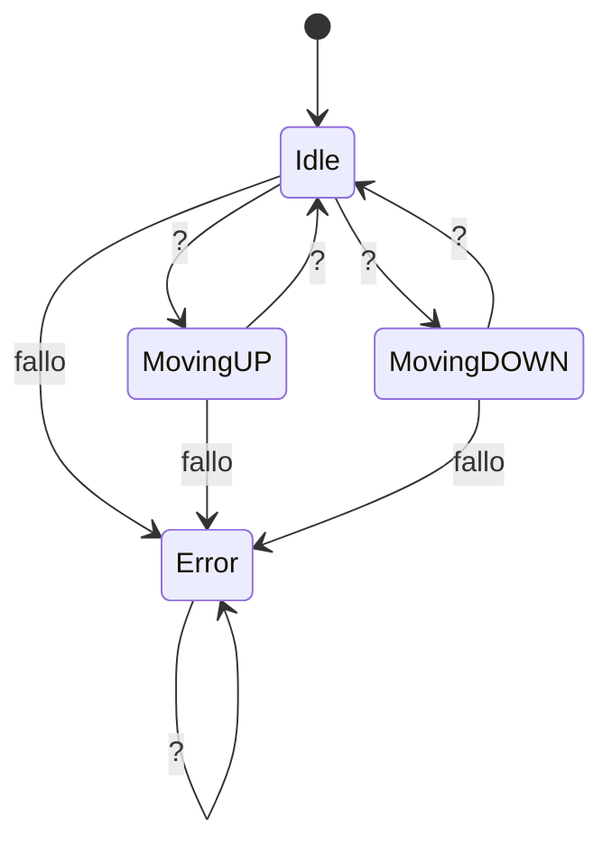

# Examen Máquina de Estados

## Descripción

En el examen tendrás que hacer una máquina de estados que controle el mecanismo del ["Halo de Vigo"](https://hoxe.vigo.org/movemonos/movilidad_vigo_vertical.php?idpoi=4849&lang=gal).

Puedes hacer un fork de este repositorio, clonarlo o simplemente descargarlo.

## Entrega

Debes entregar el enlace a tu repositorio en los primeros minutos en la hora del examen.

Tienes que hacer un fichero SOLUCION.md en el que expliques cómo has implementado la máquina de estados y cómo funciona.

Tienes que hacer commits con frecuencia, al menos uno por criterio de cualificación (ver más adelante)

> [!IMPORTANT]
> Respetar TODOS los nombres de estados, transiciones y variables que se especifican en este fichero.
> 
> Si no se respetan *literalmente* no se tendrán en cuenta para la corrección.

## Estados

- Idle: Estado de reposo, puede ser anto en el nivel 0 (nivel Avenida G. Barbón) o como en el nivel 1 (nivel Plaza de Compostela).
- MovingUP: Estado en el que el mecanismo se encuentra subiendo.
- MovingDOWN: Estado en el que el mecanismo se encuentra bajando.
- Error: Estado de error, el mecanismo no se encuentra en ningún nivel y no se puede mover

## Botonera interior

En el interior del ascensor hay una botonera con dos botones:

- `nivel_0` : Botón que indica que se quiere ir al nivel 0 (Avenida G. Barbón)
- `nivel_1` : Botón que indica que se quiere ir al nivel 1 (Plaza de Compostela)

## Niveles

Existen tres tipos de valores para los niveles:

-  0: Nivel Avenida G. Barbón
-  1: Nivel Plaza de Compostela
-  2: El mecanismo se encuentra en movimiento, no está en ningún nivel.
- -1: Error

Estos valores deben ser guardados en una variable llamada `nivel_actual` que se inicializa a 0.

> [!IMPORTANT]
> Las variables del código base suministrado tienen un **tipo de datos** orientativo
>
> **Debes** tomar decisiones del tipo de datos que consideres más adecuado para cada variable, pero **no puedes cambiar el nombre de las variables**.

## Diagrama de estados

## Criterios de Cualificación

### Tipo de variables (20 puntos)

- Elige adecuadamente el tipo de variables conforme las explicaciones de clase
- Utiliza variedad de tipos con configuraciones completas y adecuadas a la situación

### Estados (20 puntos)

- Implementa los estados teniendo en cuenta las indicaciones de clase

- Utiliza varias funciones dentro de los estados para realizar las acciones necesarias

### Transiciones (20 puntos)

- Decide las transiciones entre estados
- Las utiliza para decidir como la máquina cambia de estados utilizando sintaxis dadas en clase

### Test (20 puntos)

- Realiza un número extenso de test unitarios para comprobar el funcionamiento de la máquina de estados.

### Documentación (20 puntos)

- Realiza un SOLUCION.md explicando cómo ha implementado la máquina de estados y cómo funciona.

- Utiliza varios formatos de markdown y diagramas para explicar el funcionamiento de la máquina de estados.

### Commits (si no se realiza se descuenta -20 puntos)

- Realiza commits con frecuencia, al menos uno por criterio de cualificación.
