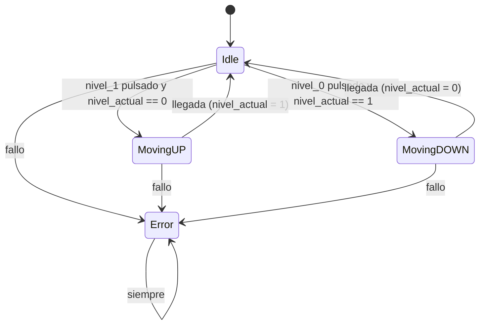
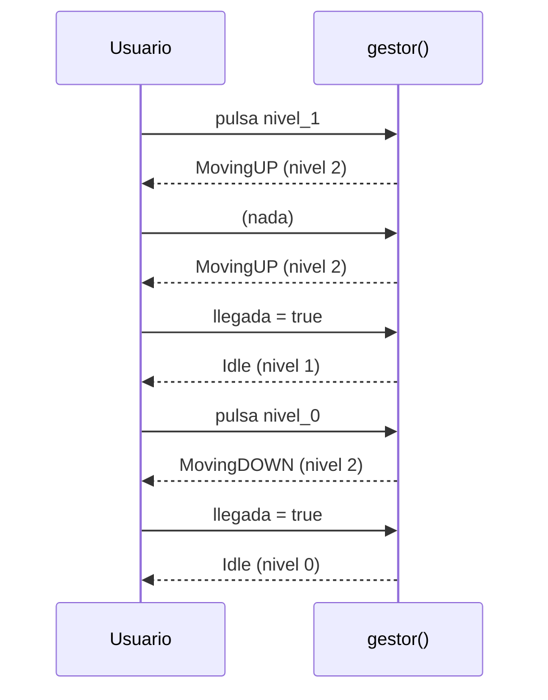

# Solución: Máquina de estados del Halo de Vigo

## 1. Introducción

He implementado en Kotlin una máquina de estados que controla el mecanismo del **Halo de Vigo**, el ascensor que une la Avenida G. Barbón (nivel 0) con la Plaza de Compostela (nivel 1).

El código está en tres ficheros:

| Fichero | Contenido |
|---------|-----------|
| `Estados.kt` | La `sealed class Estados` con los 4 estados |
| `Gestor.kt` | Variables, funciones de cada estado, transiciones y la función `gestor()` |
| `Main.kt` | Una pequeña simulación para ver cómo funciona |

Los tests están en `src/test/kotlin/org/danielcastelao/dam/GestorTest.kt`.

## 2. Variables

Elegí el tipo de cada variable según lo que representa:

| Variable | Tipo | Valor inicial | Para qué sirve |
|----------|------|---------------|----------------|
| `nivel_actual` | `Int` | `0` | Nivel del ascensor (0, 1, 2 o -1) |
| `estado_acual` | `Estados` | `Estados.Idle` | Estado actual de la máquina |
| `nivel_0` | `Boolean` | `false` | Botón de la botonera para ir al nivel 0 |
| `nivel_1` | `Boolean` | `false` | Botón de la botonera para ir al nivel 1 |
| `llegada` | `Boolean` | `false` | Sensor que avisa de que se ha llegado al destino |
| `fallo` | `Boolean` | `false` | Indica que hay un fallo en el mecanismo |

> [!NOTE]
> El nombre `estado_acual` (sin la "t") lo dejé tal cual venía en el código base, porque el README dice que no se pueden cambiar los nombres de las variables.

Los botones, el sensor y el fallo son `Boolean` porque solo pueden estar activados o no. El nivel es un `Int` porque tiene cuatro valores posibles. Para no escribir "números mágicos" en el código, definí constantes con `const val`:

```kotlin
const val NIVEL_0: Int = 0          // Avenida G. Barbón
const val NIVEL_1: Int = 1          // Plaza de Compostela
const val NIVEL_MOVIMIENTO: Int = 2 // en movimiento
const val NIVEL_ERROR: Int = -1     // error
```

## 3. Estados

Los estados están en una `sealed class`. La ventaja es que, al usar `when` sobre ella, el compilador obliga a tratar **todos** los estados.

| Estado | Descripción | `nivel_actual` |
|--------|-------------|----------------|
| `Idle` | En reposo, en el nivel 0 o en el nivel 1 | `0` o `1` |
| `MovingUP` | Subiendo | `2` |
| `MovingDOWN` | Bajando | `2` |
| `Error` | Fallo, no se puede mover | `-1` |

Cada estado tiene su propia función, para no meter todo el código dentro de `gestor()`:

- `accionesIdle()`
- `accionesMovingUP()`
- `accionesMovingDOWN()`
- `accionesError()`

## 4. Transiciones

### 4.1 Diagrama de estados



### 4.2 Tabla de transiciones

| Estado origen | Condición | Estado destino | `nivel_actual` al terminar |
|---------------|-----------|----------------|----------------------------|
| `Idle` | `nivel_1` y está en el nivel 0 | `MovingUP` | `2` |
| `Idle` | `nivel_0` y está en el nivel 1 | `MovingDOWN` | `2` |
| `Idle` | `fallo` | `Error` | `-1` |
| `MovingUP` | `llegada` | `Idle` | `1` |
| `MovingUP` | `fallo` | `Error` | `-1` |
| `MovingDOWN` | `llegada` | `Idle` | `0` |
| `MovingDOWN` | `fallo` | `Error` | `-1` |
| `Error` | cualquiera | `Error` | `-1` |

### 4.3 Funciones de transición

Para cambiar de estado uso funciones pequeñas, así cada transición está en un único sitio:

- `iniciarSubida()`: `Idle` → `MovingUP`
- `iniciarBajada()`: `Idle` → `MovingDOWN`
- `finalizarMovimiento(nivelDestino)`: `MovingUP`/`MovingDOWN` → `Idle`
- `activarError()`: cualquier estado → `Error`
- `limpiarBotonera()`: pone `nivel_0` y `nivel_1` a `false`

## 5. Cómo funciona `gestor()`

`gestor()` se llama **una vez por ciclo**. En cada llamada:

1. Si hay `fallo` y no estamos ya en `Error`, pasa a `Error` (el fallo tiene prioridad sobre todo lo demás).
2. Si no, según el estado actual con un `when`, llama a la función de ese estado, que comprueba sus transiciones.
3. Limpia la botonera (los botones se "consumen" en cada ciclo).
4. Devuelve `nivel_actual`.

```kotlin
fun gestor(): Int {
    if (fallo && estado_acual !is Estados.Error) {
        activarError()
    } else {
        when (estado_acual) {
            is Estados.Idle -> accionesIdle()
            is Estados.MovingUP -> accionesMovingUP()
            is Estados.MovingDOWN -> accionesMovingDOWN()
            is Estados.Error -> accionesError()
        }
    }
    limpiarBotonera()
    return nivel_actual
}
```

### 5.1 Ejemplo: un viaje completo



## 6. Decisiones de diseño

- **Pulsar el botón del nivel donde ya estás** no hace nada, el ascensor sigue en `Idle`.
- **Pulsar botones mientras se mueve** se ignora, y no se guardan para después. Si no, al llegar volvería a moverse solo.
- **Los dos botones a la vez**: gana el que tiene sentido según el nivel. En el nivel 0 sube y en el nivel 1 baja.
- **`Error` es un estado final**: aunque `fallo` vuelva a `false` o se pulsen botones, no sale de ahí.
- **El fallo** gana a la llegada y a los botones.

## 7. Tests

Hay **41 tests unitarios** en `GestorTest.kt`. Antes y después de cada uno se restauran todas las variables a su valor inicial, para que no dependan unos de otros.

| Grupo | Qué comprueba |
|-------|---------------|
| Estado inicial | Que empieza en `Idle`, nivel 0 y todo a `false` |
| Acciones de cada estado | El `nivel_actual` que deja cada estado |
| `Idle` → `MovingUP` / `MovingDOWN` | Botones correctos, botones del mismo nivel, ambos botones y sin pulsar |
| `MovingUP` / `MovingDOWN` → `Idle` | Con y sin `llegada`, y botones ignorados mientras se mueve |
| Fallo → `Error` | Desde los tres estados y prioridad sobre `llegada` y botones |
| `Error` → `Error` | Con botones, con `llegada` y con `fallo = false` |
| Botonera | Que se limpia después de cada ciclo |
| Funciones auxiliares | `iniciarSubida`, `iniciarBajada`, `finalizarMovimiento`, `activarError` |
| Recorridos completos | Subir y bajar, fallo a mitad de la subida y varios viajes seguidos |

Para ejecutarlos:

```bash
./gradlew test
```

## 8. Historial de commits

Hice un commit por cada criterio de cualificación:

1. Tipos de variables
2. Estados
3. Transiciones
4. Test
5. Documentación
